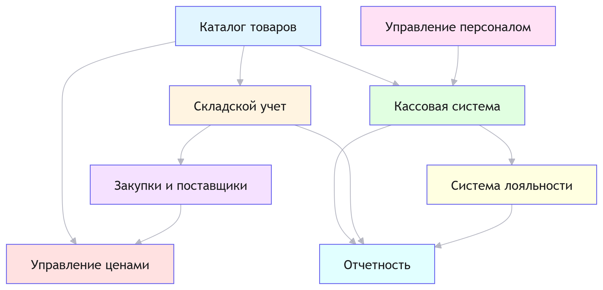

# 🏪 Архитектура ИС Супермаркета

## Общая схема подсистем и связей

Диаграмма показывает 8 основных модулей системы и связи между ними.

## Описание модулей

| № | Модуль | Описание |
|---|--------|----------|
| 1 | 📦 Каталог товаров | Центральный справочник всех товаров, категорий, штрихкодов |
| 2 | 🏭 Складской учёт | Остатки, приход/расход, инвентаризация, перемещения |
| 3 | 💰 Кассовая система | Чеки, оплаты, смены, возвраты |
| 4 | 💳 Система лояльности | Клиенты, карты, баллы, уровни, персональные скидки |
| 5 | 👥 Управление персоналом | Сотрудники, должности, графики, зарплата |
| 6 | 🚚 Закупки и поставщики | Договоры, заказы, прайс-листы, рейтинги |
| 7 | 📊 Отчётность и аналитика | Дашборды, KPI, ABC/XYZ анализ, экспорт |
| 8 | 🏷️ Управление ценами | Прайсы, акции, наценки, ценники, конкуренты |

## Основные потоки данных

- **Каталог → Склад**: товары имеют остатки
- **Каталог → Касса**: продажа товаров из каталога
- **Склад → Закупки**: приёмка товара от поставщиков
- **Касса → Лояльность**: начисление баллов при покупке
- **Закупки → Цены**: закупочные цены влияют на розничные
- **Все модули → Отчёты**: данные для аналитики