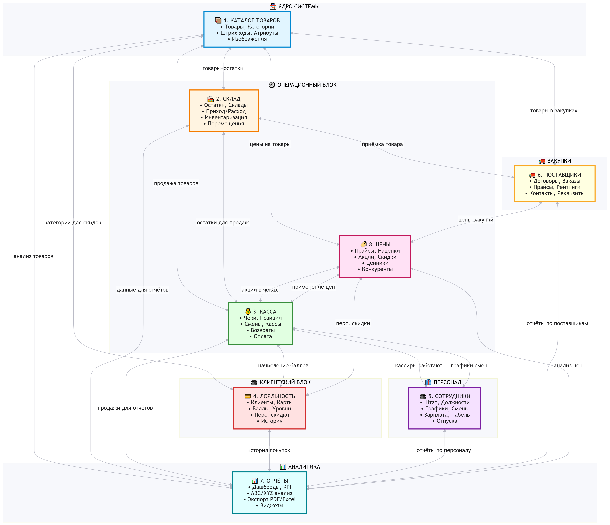

# 🗄️ ER-диаграмма ИС Супермаркета

## Схема базы данных

Диаграмма показывает все сущности системы и связи между ними.

## Статистика системы

| Показатель | Значение |
|------------|----------|
| Всего модулей | 8 |
| Таблиц в БД | 53 |
| Связей между сущностями | 66 |
| Примеров записей | ~10,000+ |

## Группы сущностей

### 📦 Каталог
- Товары, Категории, Штрихкоды, Атрибуты, Изображения, Единицы измерения

### 🏭 Склад
- Склады, Остатки, Приходные накладные, Расходные накладные, Инвентаризация, Перемещения

### 💰 Касса
- Чеки, Позиции чека, Кассовые аппараты, Смены, Возвраты, Способы оплаты

### 💳 Лояльность
- Клиенты, Карты, Уровни, Баланс баллов, Начисления, Списания, Персональные скидки

### 👥 Персонал
- Сотрудники, Должности, Отделы, Графики, Рабочие смены, Зарплата, Отпуска

### 🚚 Закупки
- Поставщики, Договоры, Контакты, Заказы, Позиции заказа, Прайс-листы, Рейтинги

### 📊 Отчёты
- Отчёты, Дашборды, Виджеты, ABC-анализ, KPI, Экспорт

### 🏷️ Цены
- Прайс-листы, Акции, Правила акций, История цен, Конкуренты, Наценки, Ценники